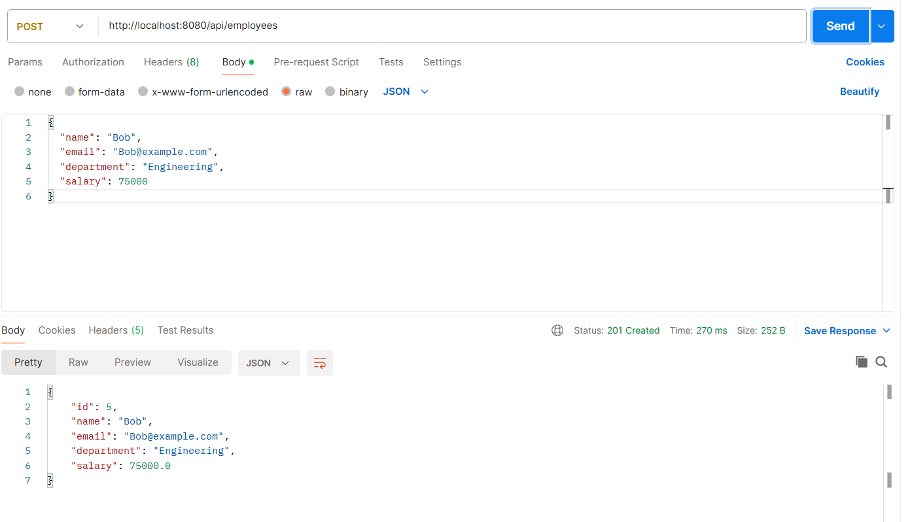
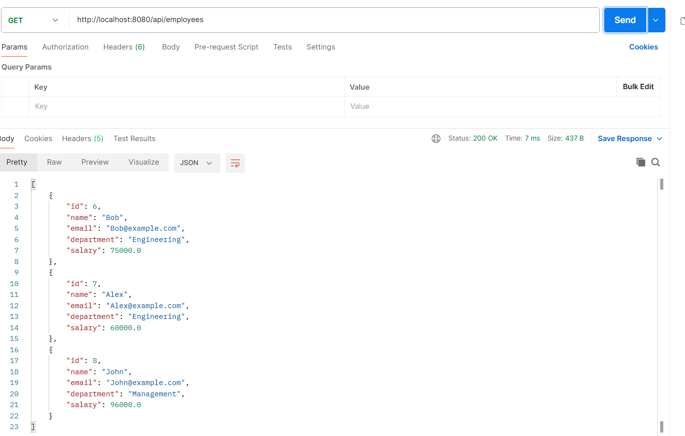
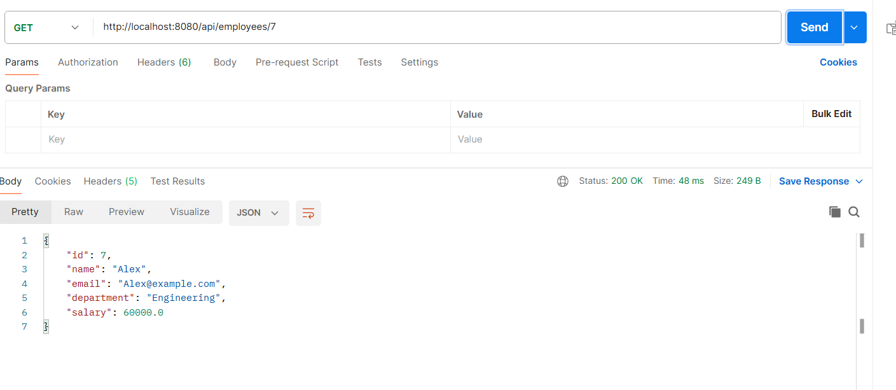
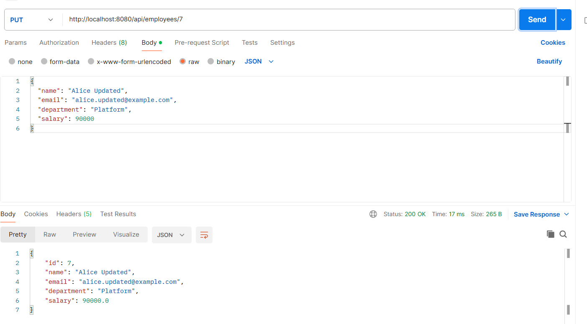
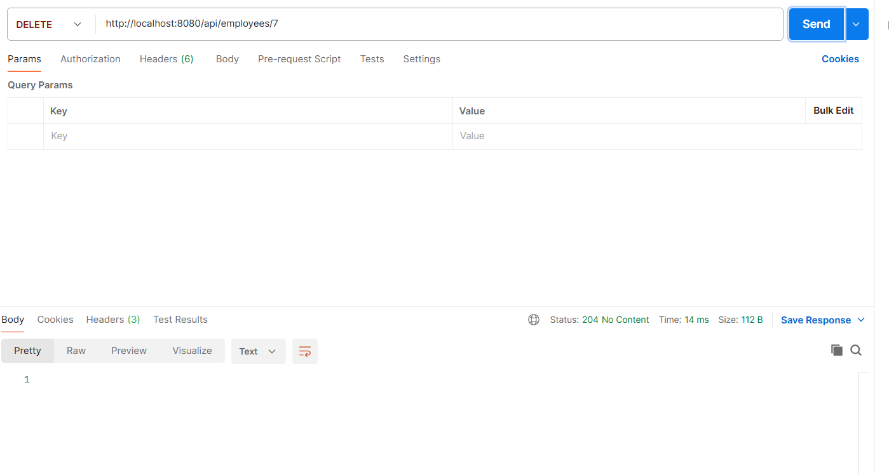

# Employee Management — Spring Boot + Redis + Nexus

## Overview

This project implements an employee management system using Spring Boot, MySQL, Redis caching, Maven, and Nexus Repository.

The solution consists of two applications:

* **Employee Library** — reusable Maven library published to Nexus.
* **Employee Redis Application** — consumes the Employee Library from Nexus and provides Employee CRUD APIs with Redis caching.

## Technology Stack

* Java 21
* Spring Boot 4.1.1
* Spring Web MVC
* Spring Data JPA
* MySQL
* Spring Data Redis
* Spring Cache
* Maven
* Nexus Repository
* Redis
* Docker
* Postman

## Project Structure

```text
employee-assignment/
│
├── employee-library/
│   └── Reusable employee library
│
├── employee-redis-app/
│   └── Spring Boot REST application
│
└── docker-compose.yml
```

## Employee Library

The Employee Library is packaged as:

```text
com.nashtech.employee:employee-library:1.0.0
```

The artifact is published to the Nexus hosted Maven repository:

```text
employee-releases
```

Nexus repository:

```text
http://localhost:8081
```

The library is consumed by the Employee Redis Application through Maven.

## Running Nexus and Redis

Start the required Docker containers:

```powershell
docker compose up -d
```

Verify the containers:

```powershell
docker ps
```

Redis is available on:

```text
localhost:6379
```

Nexus is available on:

```text
http://localhost:8081
```

## Build Employee Library

Navigate to the library:

```powershell
cd employee-library
```

Build and publish the artifact:

```powershell
mvn clean deploy
```

The artifact is published to the Nexus `employee-releases` repository.

## Employee Redis Application

Navigate to:

```powershell
cd employee-redis-app
```

Build the application:

```powershell
mvn clean package
```

Run the application:

```powershell
mvn spring-boot:run
```

The application runs on:

```text
http://localhost:8080
```

## REST APIs

### Create Employee

```http
POST /api/employees
```

Example request:

```json
{
  "name": "Alice Smith",
  "email": "alice@example.com",
  "department": "Engineering",
  "salary": 80000
}
```

### Get All Employees

```http
GET /api/employees
```

### Get Employee by ID

```http
GET /api/employees/{id}
```

### Update Employee

```http
PUT /api/employees/{id}
```

Example request:

```json
{
  "name": "Alice Updated",
  "email": "alice.updated@example.com",
  "department": "Platform",
  "salary": 90000
}
```

### Delete Employee

```http
DELETE /api/employees/{id}
```

## Redis Caching

Redis caching is implemented using Spring Cache.

### `@Cacheable`

Employee read operations use:

```java
@Cacheable(value = "employees", key = "#id")
```

The first request retrieves the employee from the database and stores the result in Redis.

Subsequent requests for the same employee are served from Redis until the cache entry expires or is evicted.

### `@CachePut`

Employee updates use:

```java
@CachePut(value = "employees", key = "#id")
```

The database is updated and the updated employee is stored in the Redis cache.

### `@CacheEvict`

Employee deletion uses:

```java
@CacheEvict(value = "employees", key = "#id")
```

The employee is deleted from the database and the corresponding Redis cache entry is removed.

## Cache TTL

Redis cache entries are configured with a TTL:

```java
.entryTtl(Duration.ofSeconds(30))
```

The TTL can be verified using Redis CLI:

```powershell
docker exec -it employee-redis redis-cli
```

Then:

```redis
TTL "employees::1"
```

The TTL decreases over time and the key is automatically removed after expiration.

## Verification

The implementation was verified using:

* Maven build
* Nexus artifact publishing
* Nexus artifact consumption
* Postman REST API testing
* Redis CLI
* Redis cache inspection
* Cache update and eviction
* TTL expiration


## Screenshots

### Create Employee API



### Get All Employee API



### Get Employee By Id API



### Update Employee



### Delete Employee

